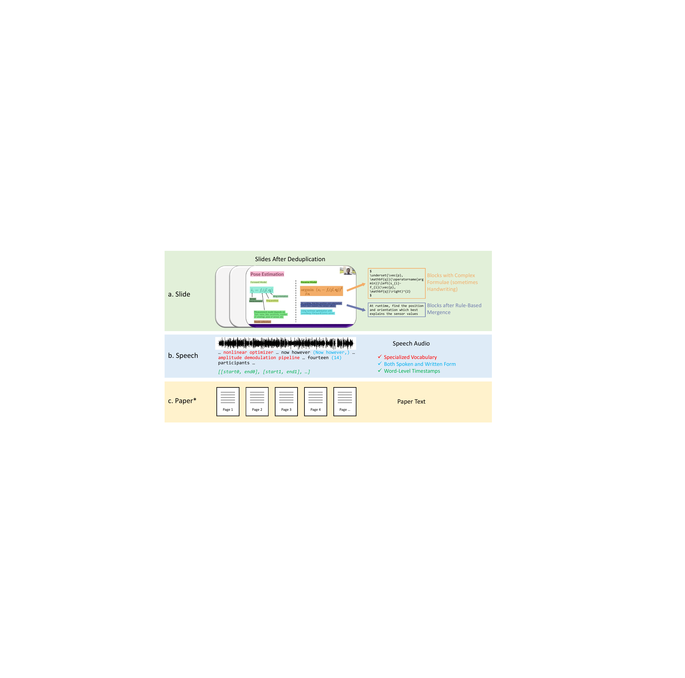
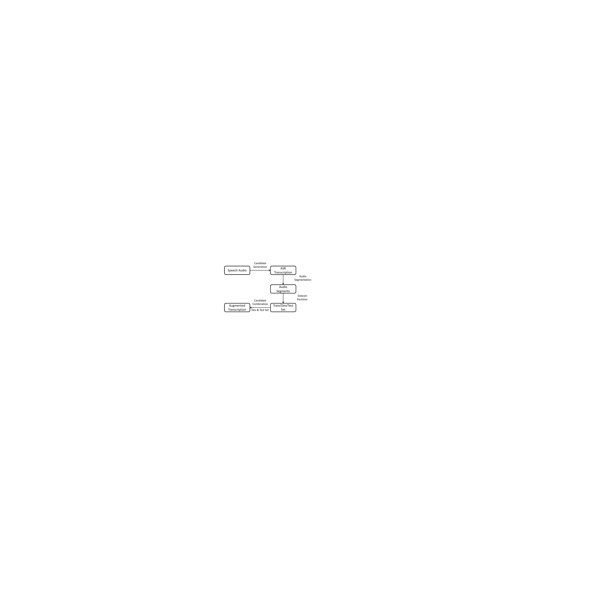
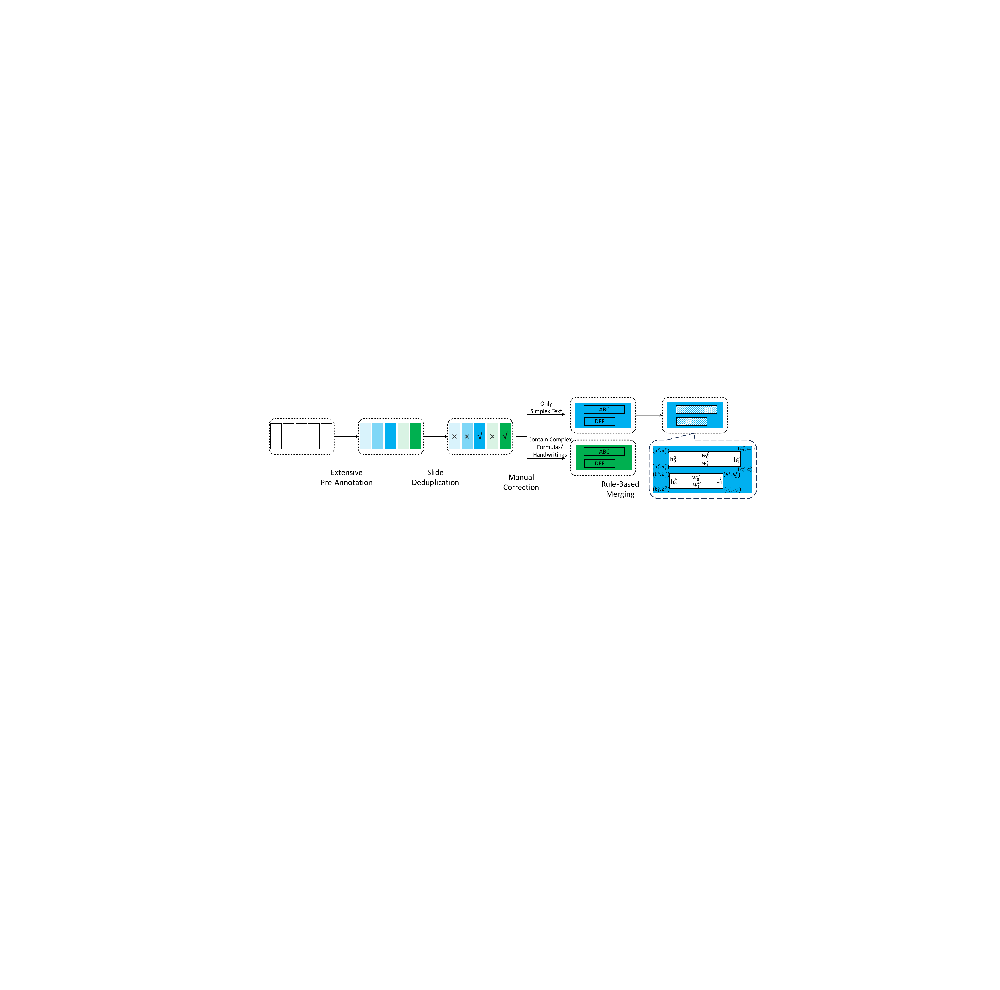

# TL;DR

- Датасет из 1113 YouTube-лекций (366.9 ч, 5 источников), с OCR-разметкой слайдов и транскрипциями речи; 3 бенчмарка: CASR, spontaneous TTS, Slide↔Script generation [§3, §5].
- Заявленные «high-quality human annotations» речи неверны для 80.5% корпуса: train-сплит (295.4 ч) — чистый выход Microsoft STT без единой правки человеком [§4.2.4, Tab. 3].
- Оценка ASR ведётся против меток, порождённых теми же Whisper/Microsoft, что и оцениваются; цифра «WER 10%» измеряет согласие с Microsoft STT, а не точность [§5.1.3, Tab. 5].
- Главная «фича» — рукописный текст и формулы — это 772 страницы (3.1% слайдов), и ни один бенчмарк на OCR-разметке вообще не запущен [§3.3, Tab. 4].
- Human-оценки: MOS на 20 сэмплах, SSG на 100 сэмплах × 3 аннотаторов из команды авторов, без IAA, без CI, без тестов значимости [§5.2.3, §5.3.3, App. A.4].
- Код и данные реально доступны (45.5 ГБ, CC BY-NC-SA), но GPT-4 вызывается через незапиненный алиас `gpt-4` и снятый с обслуживания `gpt-4-vision-preview` → числа в Tab. 7 невоспроизводимы.

---

# Problem & Motivation

Заявленный авторами разрыв: существующие датасеты академических лекций делятся на два непересекающихся класса. Одни (LectureVideoDB, SlideSpeech) заточены под *распознавание* мультимодального контента, другие (LectureBank, TalkSumm, AVIATE, LPM) — под *понимание* академического знания, и ни один не поддерживает оба режима одновременно. Причина, по мнению авторов, — недостаток качественной ручной разметки [§1, §2]. Из этого выводится необходимость корпуса, где одновременно есть: (а) вручную выверенный OCR слайдов, включая рукописный текст и формулы в LaTeX, (б) выверенные транскрипции речи с пословными таймингами и в двух формах (spoken/written), (в) тексты соответствующих статей как внешний источник знания.

Мотивация правдоподобна, но сама постановка «gap» построена на таблице сравнения (Tab. 1 в §2), где авторы сами расставляют метки «A» (автоматическая обработка) и «M» (полностью или частично ручная). Формулировка «fully **or partially** manual» делает колонку почти бессодержательной: M³AV получает «M» в колонке Transcription на том основании, что часть сегментов dev/test прошла через MTurk, при том что 80.5% корпуса по длительности — необработанный выход коммерческого ASR. По той же логике «M» могли бы получить и несколько конкурентов. Утверждение «none of them has yet simultaneously paid attention to recognition and understanding» [§1] проверяется только этой таблицей и не подкреплено ни одним экспериментом, где бы существующий датасет провалил задачу M³AV.

Второй слой мотивации — прикладной: помощь исследователям в подготовке презентаций, генерация скриптов по слайдам и слайдов по скриптам. Здесь мотивация сильнее, потому что задача SSG действительно новая относительно LPM (там — кросс-модальный retrieval, а не генерация).

К генерации образовательных видео в стиле Manim/3Blue1Brown работа отношения не имеет: анимации не собираются, видеоряд вообще не распространяется (см. «Как собирались данные»), сохраняются только кадры-слайды и аудио. Ближайшая точка соприкосновения — сплит Oxford Mathematics (MLS), где есть рукописные выкладки и формулы в LaTeX, но это 51 видео, 26.2 ч и 577 слайдов, т.е. 2.3% корпуса по слайдам.

---

# Method (пайплайн построения датасета)

Метода в привычном смысле здесь нет — есть пайплайн разметки, который и является главным техническим вкладом. Разбираю его подробно, потому что все претензии к работе растут именно отсюда.

## Как собирались данные

**Источники.** Пять YouTube-плейлистов, все публично доступные [§4.1]:

| Источник | Область | Часы | Видео | Слайды | Статьи |
|---|---|---:|---:|---:|---:|
| CHI 2021 Paper Presentations | HCI / CS | 53.2 | 660 | 9195 | 660 |
| UbiComp 2020 Presentations | HCI / CS | 10.4 | 107 | 1451 | 107 |
| NIH Director's Wednesday Afternoon Lectures | биомед | 235.4 | 228 | 11208 | — |
| Introduction to the Principles and Practice of Clinical Research (IPPCR) | биомед | 41.7 | 67 | 2525 | — |
| Oxford Mathematics | математика | 26.2 | 51 | 577 | — |
| **Итого** | | **366.9** | **1113** | **24956** | **767** |

Цифры по часам и слайдам — из Fig. 5(a,b); суммарные — из §3.2 и §3.3. В README репозитория указаны исходные длительности плейлистов (55.00 / 10.65 / 237.71 / 42.27 / 27.23 = 372.86 ч), т.е. ~6 ч отброшено при фильтрации; в статье это расхождение не объясняется.

**Ключевой факт о балансе:** NIH — 64.2% всей длительности корпуса при 20.5% видео. Тест-сплит: NIH 23.5 ч из 36.4 ч = 64.6%. То есть все агрегированные метрики в Tab. 5 — это, по сути, метрики на биомедицинских лекциях NIH. Слово «Multigenre» в названии данными не поддержано: разбивки результатов по источникам нет ни в одной таблице.

**Скачивание.** Видео, описания и субтитры качаются с YouTube. Для CS-видео (CHI + UbiComp = ровно 767 = число статей в Tab. 2) скачиваются PDF статей и парсятся через `science-parse` (AllenAI) [§4.1]. Файл `download/paper_link.json` в репозитории содержит ровно 767 непустых ссылок, все — на `dl.acm.org/doi/pdf/...`. В релизе распространяется не PDF, а `paper/paper_sentences.json` — список предложений статьи.

**Транскрипция речи (4 шага)** [§4.2]:

1. *Генерация кандидатов.* Авторские субтитры YouTube признаны низкокачественными «по нашему наблюдению» (без измерений). Вместо них — два коммерческих/открытых ASR: **Microsoft STT** (даёт written-форму $M_w$ и spoken-форму $M_s$) и **Whisper-large-v2** (только written, $W_w$). Обоснование выбора: «оба дают WER < 10% или даже < 5% на нескольких тестах SpeechColab Leaderboard в октябре 2022» [§4.2.1].
2. *Сегментация аудио.* Ре-сегментация по пословным таймингам $M_w$. Правила [App. A.1]: разрез разрешён при паузе > 0.2 с или на `.`/`!`/`?`; сегмент замыкается при накоплении ≥ 8 с или если добавление следующего куска даст ≥ 10 с; пауза > 5 с выбрасывается и режет сегмент.
3. *Разбиение на сплиты.* Примерно 8:1:1 по длительности. Заявлено, что один и тот же спикер не попадает в разные сплиты, и идентифицируется он «по вступительной информации и тексту описания» [§4.2.3]. По факту (`download/set_split.json`): train 901 / dev 99 / test 113 видео; в тесте CHI 58, NIH 22, Ubi 16, IPP 13, MLS 4.
4. *Комбинация кандидатов.* **Train: берутся напрямую $M_w$ и $M_s$ от Microsoft, без участия человека.** Dev/test: если $M_w \approx W_w$ («approximately equal», с прощением рассогласований на паузах и частотных словах) — Case I, метки берутся как есть от Microsoft; иначе Case II: рассогласованные слова маскируются как `[???]` в $M_s$, MTurk-аннотаторы заполняют маски ($M_s^{a}$), затем другие аннотаторы объединяют $M_s$ и $M_s^{a}$ в финальный $M_s^{c}$ [§4.2.4].

Постобработка $M_s^c$ [App. A.3]: inverse text normalization (NeMo WFST), расстановка пунктуации и капитализация (NeMo), пословные тайминги через Montreal Forced Aligner.

**Аннотация слайдов (4 шага)** [§4.3]:

1. *Пре-аннотация.* Сэмплирование кадров 1 fps + **PaddleOCR** для детекции и распознавания текста.
2. *Дедупликация.* Автоматически: удаляются кадры с блоками обложки $B_{\text{cover}}$ и фиксированные логотипы $B_{\text{excluded}}$; фильтрация блоков с малым числом букв ($\min^{\text{B}}_{\text{alpha}}$) и кадров со слишком малым/большим числом блоков ($\min^{\text{I}}_{\text{B}}$, $\max^{\text{I}}_{\text{B}}$); затем кадры группируются в сегменты по модифицированной ошибке [App. A.2]:
   $$\text{WER}^{\text{mod}} = \frac{S + D + 0 \times I}{H + S + D}, \qquad \text{CER}^{\text{mod}} = \frac{S + D + 0.1 \times I}{H + S + D}$$
   Вставки почти не штрафуются — это сделано специально, чтобы инкрементально дополняемый слайд считался «тем же» слайдом. Пороги подбираются вручную под каждый источник. Затем — ручная дедупликация с сохранением последнего кадра сегмента.
3. *Ручная коррекция.* Простой текст правят «опытные исследователи» из команды (координаты + содержимое), блоки с URL и e-mail выбрасываются. Сложные кадры (рукопись, формулы) пре-размечаются через **Mathpix OCR API**, затем правятся вручную; формулы — inline LaTeX. Интерфейс — PPOCRLabel.
4. *Правила слияния строк в абзацы.* Три геометрических критерия с параметрами $a=b=0.8$, $c=0.6$:
   $$\max(h_0^a, h_0^b) - \min(h_0^a, h_0^b) \leq a \cdot \max(h_0^a, h_0^b)$$
   $$\min(a_2^x, b_1^x) - \max(a_3^x, b_0^x) \geq b \cdot \min(b_1^x - b_0^x,\ a_2^x - a_3^x)$$
   $$b_0^y - a_3^y \leq c \cdot \min(h_0^a, h_0^b)$$

**Объём и формат релиза.** HuggingFace `CHHHH/M3AV_v1.0`, 45.5 ГБ: `dataset_v1.0_noaudio.tar.gz` (2.02 ГБ — JPG слайдов в `ocr/seg_imgs/`, `ocr/ocr_result.json` с полигонами и текстом блоков, `ocr/seg_speech_ocr.json` со сшивкой слайд↔речь, `speech/final+timestamps.json`, `paper/paper_sentences.json`) + 9 частей `dataset_v1.0_onlyaudio` (43.5 ГБ). **Видеоряд не распространяется** — только `raw/*.mp4.ytbUrl` со ссылкой на YouTube. Лицензия CC BY-NC-SA 4.0 при явной оговорке «M³AV doesn't own the copyright of the videos».

**Оплата аннотаторов** [App. A.4]: MTurk masters получают **0.06 USD за сэмпл** за заполнение масок и столько же за объединение; **0.2 USD за батч** из 6 TTS-сэмплов + trap-сэмпл для MOS. Ставка в час не указана. OCR-разметку делали «опытные исследователи команды», получившие «appropriate remuneration» — без цифр.

**Контроль качества** [§4.3.3, App. A.4]: «мы сэмплировали результаты 9 аннотаторов индивидуально и проверяли, есть ли у 120 размеченных изображений большое число пропусков или ошибок, не более 10 ошибочных элементов». Формулировка неоднозначна (120 изображений всего или на аннотатора?), но в любом случае это ≤ 0.5% от 24956 слайдов. Ни IAA, ни оценённого error rate, ни доли отклонённых работ не приводится.

## Бенчмарки

- **ASR/CASR.** Свои системы: AED (Conformer-12 encoder, $d^{\text{ff}}=2048$, $d^{\text{att}}=512$, $H=8$, Transformer-декодер на 6 блоков, BPE 1k, CTC-вес 0.3/0.2, SpecAugment, 4×RTX 3090, 60 эпох, усреднение top-10 чекпоинтов) и RNN-T (Conformer-15, joint 320). Плюс предобученные Whisper-v3, Wav2Vec2+CTC, NeMo Conformer-Transducer/CTC, SeamlessM4T-v2. CASR — TCPGen с GNN-кодированием префиксного дерева; редкие слова = всё, кроме топ-5k по частоте в train (≈38k слов из ≈43k словаря); biasing list длиной 500 при обучении и 1000 при инференсе [App. B.1, B.2].
- **Spontaneous TTS.** MQTTS (двухстадийная: HiFi-GAN-квантизатор 600k шагов + авторегрессионный Transformer над кодами, обусловленный speaker embedding), обучен на train M³AV. Сравнение с Bark и SpeechT5 [App. B.3].
- **SSG.** Slide→Script: каскад (gold OCR-текст → LLaMA-2-7B/13B с LoRA, либо GPT-4) и интегрированные (fine-tuned InstructBLIP-7B/13B, GPT-4V). Script→Slide: LLaMA-2, GPT-4. RAG: топ-3 предложения статьи с косинусной близостью > 0.5 по `msmarco-distilbert-base-v4`. Генерация: nucleus sampling top_p 0.9, max 300 токенов [App. B.4].

---

# Experiments & Results

**ASR/CASR (Tab. 5).** Собственные системы: AED 10.0% WER (dev и test), RNN-T 10.3/10.6%. BWER (доля ошибок на редких словах) — 35.5–38.0%, т.е. втрое хуже общего WER. Предобученные: Whisper-v3 7.1/7.2% WER (помечен курсивом «for reference only»), NeMo Conformer+Transducer 10.7/10.5%, Conformer+CTC 11.1/11.1%, SeamlessM4T-v2 17.1/18.6%, Wav2Vec2+CTC 28.3/28.5%. CASR с TCPGen: список из 1000 случайных дистракторов → BWER 26.7/27.1; список «OCR + редкие слова той же темы» → 30.5/31.7 (хуже); только OCR-слова → 22.9/25.0. Итоговое заявление: относительное падение BWER на 37.8% (dev) и 34.2% (test) относительно RNN-T без биасинга. Арифметика сходится (36.8→22.9; 38.0→25.0).

**TTS (Tab. 6).** MQTTS: FFE 0.3518, MCD 9.40, MOS 3.67 ± 0.94. SpeechT5: 0.4153 / 9.43 / 3.43 ± 1.09. Bark: 0.4269 / 10.57 / 3.31 ± 1.02. Ground truth: MOS 3.86 ± 1.02. MOS считался на **20 случайных сэмплах**.

**SSG (Tab. 7).** Slide→Script: LLaMA-2-13B+OCR даёт лучший ROUGE-1 (26.9), ROUGE-2 (6.4) и BERTScore (0.102); GPT-4+OCR — 26.2 / 5.8 / 0.085, но лучший BARTScore (−4.621); GPT-4V — 26.4 / 6.2 / 0.092 / −4.630. InstructBLIP проваливается (ROUGE-2 2.2–2.3). Human: InstructBLIP 2.4–2.5, LLaMA-2 3.6–3.9, GPT-4 4.6, GPT-4V 4.7. Script→Slide: GPT-4 лидирует по ROUGE (26.8/7.7/23.0) и human (4.8), LLaMA-2-13B — по BERTScore (0.092).

**RAG-абляция (Tab. 8).** Только LLaMA-2-7B, только CS-подмножество. Slide→Script: 24.9→29.2 ROUGE-1, human 3.7→4.1. Script→Slide: 20.9→22.3, human 3.3→3.6, BERTScore не меняется (0.061→0.061).

**Детальные human-оценки (Tab. 9–10, App. B.5).** GPT-4 и GPT-4V получают ровно **5.0** по fluency и relevance в обеих задачах — потолок шкалы.

---

# Критический разбор

## 1. Заявления, не подкреплённые экспериментами

**«High-quality human annotations ... of spoken words».** Это центральное утверждение аннотации и абстракта, и оно неверно для 295.4 ч из 366.9 ч (80.5%): в train-сплите метки — прямой выход Microsoft STT [§4.2.4]. Для dev/test человек трогает **только** сегменты Case II, где Microsoft и Whisper разошлись; сегменты Case I (где два ASR согласны) уходят в «gold» без единого взгляда человека. Доля Case I / Case II нигде не приводится — а это единственное число, которое позволило бы оценить реальный объём ручной работы. Обоснование для train — «показывает высокое качество, проверенное сверкой с ручной разметкой на подмножестве» [§4.2.4]: ни размера подмножества, ни измеренного WER, ни критерия «высокого качества». В таблице сравнения датасетов (Tab. 1) M³AV при этом получает «M» в колонке Transcription — это натяжка.

**Дополнительный сигнал: описание в статье расходится с релизом.** README репозитория (новость от 2024-04) утверждает: «the training set adopts the text-normalised **Whisper** results, and the development/testing set employs a manual combination of Whisper and microsoft STT results». Камера-реди ACL (стр. 706 текстового слоя PDF) и arXiv v3 говорят обратное: «For the training set, we directly adopt the **Microsoft** transcription $M_w$ and $M_s$». Одно из двух описаний ложно. Если верен README, то ситуация хуже, чем в статье: AED/RNN-T обучены имитировать Whisper, а Whisper-v3 затем оценивается на том же корпусе — и оговорка «Whisper for reference only» становится недостаточной, потому что заражены и «честные» бейзлайны.

**«Avoiding the issue of training data contamination»** [§5.1.2] — non sequitur. Аргумент: «наши видео впервые корректно транскрибированы, поэтому остальные open-source ASR можно оценивать честно». Но контаминация ASR идёт по **аудио**, а не по транскриптам: Whisper обучался на 680k ч веб-аудио, NeMo и SeamlessM4T — на смеси, куда входят публичные YouTube-корпуса. NIH WALS и Oxford Mathematics — крупные, старые, публичные плейлисты, вероятность их присутствия в pretraining-миксах высока. Никакой проверки (например, memorization probe или сравнение с приватным held-out) не проводится.

**«The diversity of M³AV makes it a challenging dataset»** (абстракт, §6). Разбивки результатов по источникам нет ни в одной таблице. Утверждение о сложности через разнообразие проверяемо только per-source метриками, которых нет. Более того, 10% WER на подготовленной лекционной речи — не «challenging» по меркам 2024 г.; на реально сложных корпусах (например, спонтанные митинги) числа кратно выше.

**«M³AV ... is completely qualified to cover tasks in the aforementioned datasets»** [§2] — то есть заменяет LectureVideoDB (распознавание рукописного/сценового текста) и SlideSpeech. Ни одного эксперимента по распознаванию текста на слайдах в работе нет. Вручную выверенный OCR — заявленный главный вклад — используется **только как gold-вход** для CASR и SSG, но никогда как gold-выход для задачи OCR. В Tab. 1 M³AV ставит себе галочку «Recognition», при том что единственная реализованная recognition-задача — ASR.

**«Real speech in our dataset can drive AI systems to simulate more natural speech»** [§5.2.3]. Вывод сделан из того, что MQTTS, обученный на M³AV, обходит Bark и SpeechT5 по MOS. Контроля нет: не обучен MQTTS на другом корпусе (например, на том же GigaSpeech-подмножестве, на котором его обучали авторы MQTTS) с оценкой на M³AV. Без этого сравнения вывод о вкладе именно *данных* невозможен.

**«GPT-4V has already exceeded the cascaded pipeline»** [§5.3.3]. Разница GPT-4V vs GPT-4+OCR: ROUGE-1 26.4 vs 26.2, ROUGE-L 23.7 vs 23.7, human 4.7 vs 4.6. Это шум, поданный как «significant observation». Ни доверительных интервалов, ни повторных запусков.

**«Open-source models ... are far from the closed-source models»** [§5.3.3] — прямо противоречит собственной Tab. 7: fine-tuned LLaMA-2-13B выигрывает у GPT-4 по ROUGE-1 (26.9 vs 26.2), ROUGE-2 (6.4 vs 5.8) и BERTScore (0.102 vs 0.085) в Slide→Script. Вывод «far from» держится исключительно на human-оценке, где GPT-4 упирается в потолок шкалы.

## 2. Слабые места бенчмарков и метрик

**Циркулярность ASR-оценки.** Референсные метки dev/test порождены Microsoft STT и Whisper. В Case I «gold» = выход Microsoft буквально. Следовательно: (а) любая система, похожая на Microsoft STT по нормализации, пунктуации и обработке чисел, получает бонус; (б) абсолютные WER не измеряют точность распознавания — они измеряют расстояние до консенсуса двух ASR; (в) даже курсивная оговорка про Whisper недостаточна, потому что Whisper участвовал в отборе того, *какие* сегменты вообще пойдут к человеку. Отсутствует базовое для датасетного пейпера число: WER финальных меток относительно независимой человеческой транскрипции хотя бы на 1–2 ч.

**Несопоставимые biasing-списки в CASR.** Три строки CASR сравниваются между собой, но условия различаются по параметру, который сильнее всего влияет на BWER, — по размеру списка. «Random distractors» — фиксированные 1000 слов. «OCR» — слова с конкретного слайда, т.е. список на порядки короче и почти наверняка содержит целевые слова. Короткий и релевантный список тривиально проще. Контроля «OCR-список, дополненный дистракторами до 1000» нет, размеры OCR-списков не приводятся. Заявленное «относительное падение BWER на 37.8%» поэтому не отделяет вклад визуальной модальности от вклада уменьшения пространства поиска. Плюс OCR-подсказки — это **вручную выверенный** OCR, а не выход реальной OCR-модели: в продакшене такого входа не бывает, оценка оптимистична по построению.

**Размер выборки и статистика.**
- MOS: 20 сэмплов [§5.2.3]. Число оценщиков на сэмпл не указано. `±` — это, судя по всему, стандартное отклонение, а не 95% CI. При разбросе ~1.0 и n=20 доверительный интервал ≈ ±0.45; разрывы MQTTS (3.67) vs SpeechT5 (3.43) и MQTTS vs GT (3.86) внутри шума. Никаких t-тестов, ANOVA или bootstrap.
- SSG human: 100 сэмплов, 3 аннотатора [§5.3.3, App. A.4]. IAA (Krippendorff's α, Fleiss' κ) не приводится. Аннотаторы — «three experienced researchers» из команды авторов; про слепоту (blind evaluation, рандомизация порядка систем) ничего не сказано. Это self-evaluation с прямым конфликтом интересов: авторы оценивают свои же бейзлайны и знают, какой из них должен выиграть. Показательно, что MTurk-разметку для SSG сначала запустили и отбросили как «unsatisfactory» — то есть решение перейти на внутренних оценщиков принималось *после* просмотра результатов.
- Потолок шкалы: GPT-4/GPT-4V получают ровно 5.0/5.0 по fluency и relevance (Tab. 9). Метрика не различает модели в верхнем сегменте и, скорее всего, отражает верифицируемую только стилистически «гладкость» длинного LLM-текста.
- Нигде нет multiple seeds. Все таблицы — одиночные прогоны.

**Метрики SSG плохо подходят задаче.** Референс для Slide→Script — реальная устная речь докладчика. Задача принципиально one-to-many: по одному слайду возможны десятки корректных скриптов. ROUGE-1 ~25 и ROUGE-2 ~6 — это уровень, на котором ранжирование систем нестабильно. BERTScore в районе 0.07–0.16 (по-видимому, rescaled) практически неинформативен. Три автоматические метрики и human-оценка дают три разных порядка систем — и авторы выбирают тот, который поддерживает нарратив «closed-source ≫ open-source».

**RAG-абляция без контроля.** Единственная проверка «внешнее знание помогает» [Tab. 8] сделана на одной модели (LLaMA-2-7B), на одном подмножестве (CS), без контрольного условия. Обязательные контроли, которых нет: (а) предложения из *случайной другой* статьи той же конференции — чтобы отделить эффект релевантного знания от эффекта дополнительного контекста и изменения формата промпта; (б) top-3 предложения из самого скрипта соседних сегментов. Кроме того, извлекается текст статьи, по которой сделана эта же презентация, а докладчики на CHI/UbiComp часто зачитывают формулировки из статьи — retrieval здесь местами близок к извлечению самого ответа.

**Нечестные сравнения в бейзлайнах.**
- TTS: MQTTS обучен на train M³AV и обусловлен speaker embedding спикера из того же домена; Bark и SpeechT5 применяются zero-shot, обучены на других данных, с другой нормализацией текста и другим целевым стилем (чистая студийная речь). Победа in-domain модели над out-of-domain — тавтология, но подаётся как свойство данных.
- SSG: LLaMA-2 и InstructBLIP файн-тюнятся на train M³AV (что даёт им стилистическое преимущество в ROUGE), GPT-4/GPT-4V вызываются zero-shot без few-shot примеров и без указания целевой длины/стиля. Сравнение смешивает три фактора: размер модели, режим обучения и формат оценки. Вывод «нужны более качественные pretraining-данные для open-source» из такого дизайна не следует.
- ASR: собственные AED/RNN-T обучены на 295 ч in-domain данных; SeamlessM4T-v2 и Wav2Vec2 — out-of-domain. То, что «Whisper лучше наших систем», честно помечено курсивом, но общая рамка «existing models showcase limited performance» [§1] опирается на смесь in-domain и out-of-domain систем.

## 3. Утечки данных

- **Аудио в pretraining.** См. выше: NIH WALS и Oxford Mathematics — публичные плейлисты с большой историей; вероятность попадания в обучающие миксы Whisper/NeMo/Seamless высока и не проверяется.
- **Циркулярные метки** dev/test → фактически утечка обучающих сигналов Microsoft/Whisper в «золотой стандарт».
- **Разделение по спикерам — эвристическое.** «Speaker ... identified by the introductory information and description text» [§4.2.3]. Ни диаризации, ни speaker embeddings, ни проверки постфактум. При этом IPP (67 видео) — это **один курс** с повторяющимися преподавателями, разбитый как 49/5/13; NIH WALS — серия, где приглашённые докладчики выступают повторно в разные годы. Риск утечки спикера в test реален и напрямую завышает как WER-результаты, так и MOS для MQTTS (модель могла видеть голос тестового спикера).
- **Тематическая утечка и утечка шаблонов слайдов.** Разбиение по видео, а не по сессиям/курсам. Соседние лекции курса IPPCR разделяют терминологию, шаблон слайдов и целые повторяющиеся слайды («Objectives», «Outline»). CHI 2021 — доклады одной конференции с общим оформлением. Для задачи Script→Slide, где метрика — совпадение текста слайда, это заметный источник завышения.
- **GPT-4 и CHI/UbiComp статьи.** Cut-off GPT-4 покрывает 2021 г.; статьи CHI 2021 и UbiComp 2020 почти наверняка в pretraining. Для Slide→Script на CS-подмножестве это прямая утечка контента в закрытую модель — что делает сравнение GPT-4 vs LLaMA-2 ещё менее интерпретируемым.
- **Редкие слова.** Список редких слов строится по частоте в train и применяется к dev/test — здесь методология корректна.

**Отдельно про статистику редких слов.** §3.2: «размер словаря spoken-формы 47865, при этом слов с частотой в пределах 1k — 47483 (99.20%)». Это утверждение истинно для практически любого естественного корпуса (закон Ципфа) и не является свидетельством особой насыщенности терминологией. Плюс расхождение с приложением: App. B.2 говорит про «примерно 43k различных слов» и «около 38k» редких. 47865 vs 43k — несогласованные числа в одной работе.

## 4. Воспроизводимость: что реально доступно

Здесь работа выглядит существенно лучше среднего датасетного пейпера, но с оговорками.

**Доступно:**
- Репозиторий `github.com/Jack-ZC8/M3AV-dataset` (последний push 2025-05-29, 24 звезды, 3 открытых issue). Есть `set_split.json` (1113 записей), `paper_link.json` (767 ссылок), SHA-256 всех архивов, демо-сэмпл с описанием формата.
- Данные на HuggingFace `CHHHH/M3AV_v1.0`, 45.5 ГБ, публично, не gated: 2.02 ГБ «noaudio» (кадры слайдов + JSON-аннотации + предложения статей) и 43.5 ГБ аудио, нарезанного на 9 частей.
- Бенчмарки: ASR — рецепт ESPnet (`egs2/M3AV/asr1`); CASR — рецепт + патчи; TTS — полный форк MQTTS (`train.py`, `trainer.py`, `infer.py`, `tester.py`, quantizer, measures); SSG — код подготовки данных, LoRA-файнтюн LLaMA-2, скрипты GPT-4/GPT-4V, скоринг ROUGE/BERTScore/BARTScore.

**Не доступно / проблемно:**
- **Видео не распространяется.** Только `raw/*.mp4.ytbUrl`. Любая работа, требующая говорящей головы, жестов, анимации переходов — невоспроизводима без повторного скачивания с YouTube, где ссылки постепенно умирают. Датасет с названием «Audio-**Visual**» на практике отдаёт аудио + статичные кадры.
- **CASR завязан на непринятый PR** ESPnet #5261 плюс ручную замену `espnet2/text/Butils.py` и `espnet2/bin/asr_inference.py`. Это гарантированный bit-rot: с любым обновлением ESPnet рецепт ломается.
- **GPT-4/GPT-4V невоспроизводимы.** В `ssg_gpt4/gpt4_generate.py` модели заданы как `model='gpt-4'` (плавающий алиас) и `model='gpt-4-vision-preview'` (снят с обслуживания). В статье версия/дата снапшота не указана. Параметры генерации: `temperature=1.0, top_p=0.9, n=1, seed=0` — `seed` в OpenAI API даёт лишь «best effort» детерминизм. Числа в Tab. 7 и Tab. 9 воспроизвести невозможно в принципе.
- **Пороги дедупликации слайдов не опубликованы.** $\min^{\text{B}}_{\text{alpha}}$, $\min^{\text{I}}_{\text{B}}$, $\max^{\text{I}}_{\text{B}}$, $\min_{\text{ER}}$ и выбор WER/CER объявлены зависящими от источника [App. A.2], но конкретные значения не даны ни в статье, ни в репозитории. Пересоздать датасет с нуля нельзя.
- **Расхождение «статья vs релиз»** про источник train-транскриптов (Microsoft в статье, Whisper в README) не разрешено нигде.
- Нет model checkpoints, нет логов обучения, нет сырых оценок аннотаторов (что не позволяет пересчитать IAA независимо).

**Лицензии и правовой статус.** Датасет выложен под CC BY-NC-SA 4.0, при этом авторы прямо признают, что не владеют правами на видео. Раздача **полного аудио** (43.5 ГБ) и извлечённых кадров чужих видео под своей лицензией — юридически спорно и различается по источникам: NIH (работа федерального агентства США, де-факто public domain) — низкий риск; CHI/UbiComp — записи, права на которые у ACM/авторов; Oxford Mathematics — права Оксфорда. Файл `paper_sentences.json` — производное от PDF с `dl.acm.org`, и его перераспространение под CC BY-NC-SA сомнительно. Раздел Ethical Consideration [§Ethics] ограничивается фразой «copyright remains with the original owners» и не разбирает эти различия. Заявление «fair payments» не подкреплено: 0.06 USD за сэмпл без указания времени на сэмпл не позволяет проверить соответствие даже минимальной ставке.

## 5. Что авторы признают сами

Раздел Limitations [§Limitations] честно перечисляет: возможные смещения по типам презентаций и демографии спикеров; ограниченность доменов (нет гуманитарных наук) и одноязычность (только английский); визуальная информация недоразмечена — иллюстрации со слайдов не извлекаются (в отличие от LPM), говорящие головы не выделяются; в задаче Slide Generation генерируется только текст слайда, не изображение.

Чего они не признают: (1) машинное происхождение подавляющей части «золотых» транскриптов; (2) циркулярность ASR-оценки; (3) отсутствие бенчмарка на собственной OCR-разметке; (4) экстремальный дисбаланс источников и отсутствие per-source результатов; (5) статистическую невесомость human-оценок.

---

# Related Work positioning

M³AV встаёт между двумя линиями работ. Линия распознавания: **LectureVideoDB** (Dutta et al., 2018; 24 видео, 5474 кадра, ручная разметка текста и рукописи, без речи) и **SlideSpeech** (Wang et al., 2023; 1705 видео, 1080 ч, автоматический OCR + ручные транскрипции). Линия понимания: **LectureBank** (Li et al., 2019; prerequisite chains), **TalkSumm** (Lev et al., 2019; 1716 суммаризаций статей из транскриптов докладов), **AVIATE** (Atri et al., 2021; 8201 видео, ~2300 ч, полностью автоматическая разметка, абстрактивная суммаризация), **LPM** (Lee et al., 2022/2023; 334 видео, 187 ч, кросс-модальный retrieval с извлечёнными иллюстрациями), **GoogleI/O** и **LaRochelle** (video-level retrieval).

Дифференцирующее заявление M³AV — единственный корпус с ручной разметкой и слайдов (включая рукопись и формулы в LaTeX), и речи, и с текстами статей, поддерживающий обе группы задач. Первая половина заявления держится на растяжимом определении «M = fully **or partially** manual»; вторая (обе группы задач) не реализована, поскольку задача распознавания текста на слайдах не бенчмаркится. По объёму M³AV меньше SlideSpeech (367 ч vs 1080 ч) и AVIATE (~2300 ч), но больше LPM (187 ч), и заметно богаче по числу типов аннотаций. Наиболее близкий конкурент по духу — LPM (выравненные слайды и речь, кросс-модальные задачи); главные реальные преимущества M³AV над ним — пословные тайминги, spoken/written формы, LaTeX-формулы и постановка генеративной задачи SSG вместо retrieval. Наследственно CASR-часть продолжает линию TCPGen (Sun et al., 2021/2023) и audio-visual contextual biasing (Sun et al., 2022), где M³AV служит новым тестовым полигоном.

Итоговая оценка: как **ресурс** M³AV полезен и аккуратно выложен — формат аннотаций продуман, код бенчмарков реально существует, данные скачиваются одним `wget`. Как **научная работа** он переоценивает степень человеческого участия в разметке, строит ASR-оценку по кругу, не бенчмаркит свой же главный артефакт (OCR), и подпирает выводы human-оценками, которые не выдерживают статистической проверки.

---

# Anchors

- `dataset_summary: source/03-the_xxx_dataset.tex:L43 — 1113 видео, 366.9 ч, перечень пяти источников`
- `rare_word_claim: source/03-the_xxx_dataset.tex:L44 — словарь 47865 слов, 99.20% с частотой < 1k (тривиально по Ципфу)`
- `split_table: source/03-the_xxx_dataset.tex:L13-17 — Tab. 3, длительности train/dev/test по источникам (295.4/35.1/36.4 ч)`
- `complex_pages_table: source/03-the_xxx_dataset.tex:L65-75 — Tab. 4, 772 страницы с рукописью/формулами, из них 577 в MLS`
- `data_collection: source/04-creation_pipeline.tex:L5-6 — сбор с YouTube, парсинг статей через science-parse`
- `asr_candidates: source/04-creation_pipeline.tex:L22 — выбор Microsoft STT и Whisper-large-v2 как источников кандидатов`
- `train_labels_machine_generated: source/04-creation_pipeline.tex:L52 — «For the training set, we directly adopt the Microsoft transcription»`
- `candidate_combination: source/04-creation_pipeline.tex:L54-62 — Case I / Case II, маскирование [???], MTurk-заполнение и объединение`
- `speaker_split_heuristic: source/04-creation_pipeline.tex:L48 — спикер определяется по вступлению и тексту описания`
- `ocr_pipeline: source/04-creation_pipeline.tex:L70-78 — PaddleOCR 1 fps, дедупликация, Mathpix для формул, QC на 120 изображениях`
- `merge_rules: source/04-creation_pipeline.tex:L86-107 — Eq. (1)-(3), правила слияния OCR-блоков, a=b=0.8, c=0.6`
- `asr_results_table: source/05-benchmarks_and_experiments.tex:L17-30 — Tab. 5, ASR и CASR (WER/BWER)`
- `contamination_claim: source/05-benchmarks_and_experiments.tex:L47 — «avoiding the issue of training data contamination»`
- `casr_conclusion: source/05-benchmarks_and_experiments.tex:L56 — относительное падение BWER на 37.8%/34.2%`
- `tts_results_table: source/05-benchmarks_and_experiments.tex:L82-86 — Tab. 6, FFE/MCD/MOS, GT 3.86±1.02 vs MQTTS 3.67±0.94`
- `mos_sample_size: source/05-benchmarks_and_experiments.tex:L95 — MOS считается на 20 случайных сэмплах`
- `ssg_results_table: source/05-benchmarks_and_experiments.tex:L113-125 — Tab. 7, ROUGE/BERTScore/BARTScore/Human для SSG`
- `rag_ablation_table: source/05-benchmarks_and_experiments.tex:L146-152 — Tab. 8, эффект добавления предложений статьи (только LLaMA-2-7B, CS-подмножество)`
- `ssg_human_protocol: source/05-benchmarks_and_experiments.tex:L169 — 100 сэмплов, 3 аннотатора, измерения SummEval`
- `ssg_claims: source/05-benchmarks_and_experiments.tex:L171 — три «significant observations», включая «far from closed-source» и превосходство GPT-4V`
- `annotator_pay: source/08-appendix.tex:L46 — 0.06 USD за сэмпл на MTurk`
- `ocr_qc: source/08-appendix.tex:L51 — контроль качества по 120 изображениям от 9 аннотаторов`
- `ssg_annotators_internal: source/08-appendix.tex:L57 — MTurk отброшен, оценивают трое исследователей команды`
- `casr_details: source/08-appendix.tex:L69-74 — 1000 дистракторов, редкие слова вне топ-5k, словарь ~43k / ~38k редких`
- `dedup_formulas: source/08-appendix.tex:L33-36 — Eq. (4)-(5), WER^mod и CER^mod с почти не штрафуемыми вставками`
- `ssg_training_details: source/08-appendix.tex:L82-84 — LoRA, lr 2e-4, 3 эпохи, top_p 0.9, max 300 токенов`
- `detailed_human_scores: source/08-appendix.tex:L100-114 — Tab. 9, GPT-4/GPT-4V получают 5.0 по fluency и relevance`
- `limitations: source/07-limit_ethi.tex:L3-9 — признанные ограничения (bias, домены, визуальная информация, текстовые слайды)`
- `ethics_license: source/07-limit_ethi.tex:L13 — CC BY-NC-SA 4.0, авторские права остаются у владельцев видео`
- `related_datatype_table: source/02-related_work.tex:L15-31 — Tab. 1, «A» vs «M» разметка по датасетам`
- `related_datasize_table: source/02-related_work.tex:L47-63 — Tab. 2 (сравнение размеров): 1113 видео, 367 ч, 24956 слайдов, 767 статей`
- `dataset_overview_figure: figures/figures_1-1.png — Fig. 1, три компонента датасета`
- `speech_pipeline_figure: figures/figures_2-1.png — Fig. 2, четырёхшаговый пайплайн транскрипции`
- `slide_pipeline_figure: figures/figures_4-1.png — Fig. 4, пайплайн аннотации слайдов`
- `statistics_figure: figures/figures_5-1.png — Fig. 5, часы/слайды по источникам (NIH 235.4 ч, MLS 577 слайдов)`

---

# Glossary

- `M³AV` — Multimodal, Multigenre, Multipurpose Audio-Visual dataset; 1113 лекционных видео с YouTube, 366.9 ч.
- `spoken form / written form` — две формы транскрипта: как произносится («one hundred thousand») и как записывается («100,000»); обе даются с пословными таймингами.
- `CASR` — Contextual ASR: распознавание с подсказкой в виде biasing list — списка редких слов, которые нужно распознать точно.
- `BWER` — biasing WER: ошибки только на редких словах, делённые на число редких слов, с учётом ложных вставок редких слов.
- `distractors` — слова, добавленные в biasing list, но отсутствующие в конкретном высказывании; имитируют реальный шумный контекст.
- `TCPGen` — Tree-Constrained Pointer Generator: комбинация символьного поиска по префиксному дереву biasing-списка и нейронного указателя.
- `SSG` — Slide and Script Generation: две зеркальные задачи, Slide→Script (по слайду породить речь докладчика) и Script→Slide.
- `MQTTS` — Multi-codebook Quantized TTS: двухстадийная TTS (квантизатор волны + авторегрессионный Transformer над кодами) для спонтанной речи.
- `Case I / Case II` — развилка в комбинации кандидатов: при согласии Microsoft и Whisper метка берётся автоматически (Case I), иначе идёт к аннотаторам (Case II).
- `seg_imgs` — каталог релиза с дедуплицированными кадрами слайдов; фактически единственная визуальная модальность, которая реально раздаётся.
