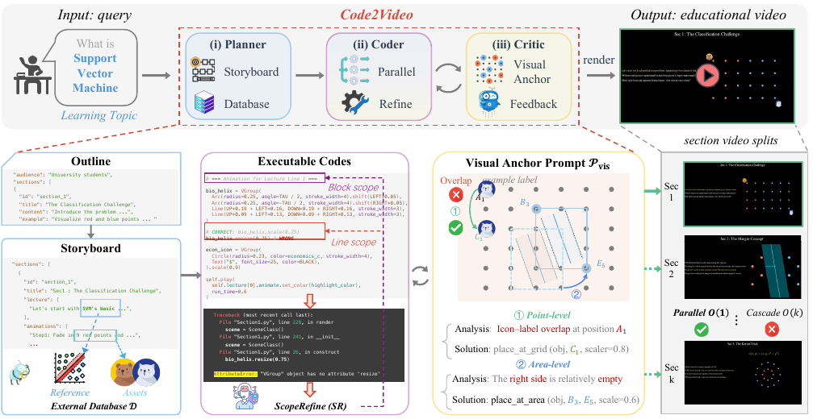
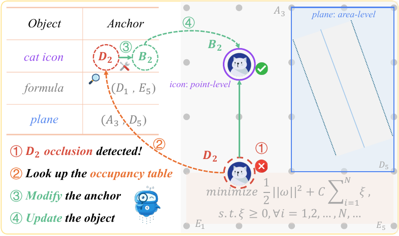
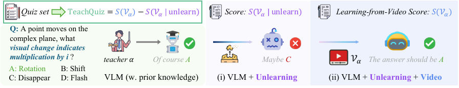

# TL;DR

- Планировщик–кодер–критик генерируют Manim-код; главный инженерный вклад — дискретизация холста в сетку 6×6 (visual anchor) и локальный автофикс ScopeRefine [§4.2, §4.3].
- Заявленный «+40%» — это +45 пунктов по шкале 0–100 против того же backbone без агента; при этом стоимость выше в 15–20× по токенам [Tab. 1].
- «Unlearning» в TeachQuiz — это промпт-инструкция отказываться отвечать. Baseline после «забывания» = 5.0% при 25% случайного угадывания и 50.6% для константного ответа «B» [§A.1.1, Tab. 5].
- Ключ ответов в выложенном quiz-наборе вырожден: B=50.6%, C=39.3%, A=8.5%, D=1.5% (585 вопросов); в репозитории 5 вопросов на тему, а в статье заявлено 10.
- Промпт VLM-судьи явно требует оценивать «presentation (left side)» и «animation (right side)» — то есть зашит под собственный layout Code2Video [source/eva_aes.tex:L17-L19].
- Данные — yt-dlp-скрейп канала 3Blue1Brown (117 видео), нарезка по YouTube-чаптерам (339 клипов, из них все — из 49 видео); Manim-исходники 3b1b/videos не использовались.

---

# Problem & Motivation

Статья атакует реальную дыру. Диффузионные и авторегрессионные text-to-video модели умеют делать 5–10-секундные красивые ролики, но не умеют: (а) рисовать читаемый текст и формулы, (б) держать пространственную композицию десятки минут, (в) выстраивать логическую последовательность «понятие → пример → повтор». Для обучающего видео все три пункта критичны, а перцептивная достоверность — вторична [§1]. Авторы предлагают сменить субстрат генерации: не пиксели, а исполняемый код (Manim), который по построению даёт детерминированность, интерпретируемость и точный контроль над временем и позицией [§1, §3.1].

Мотивация валидна, но формулировка «новая парадигма» преувеличена. Генерация Manim-кода LLM-агентом — не новая идея на момент публикации: TheoremExplainAgent (TEA, `ku2025theoremexplainagent`) делал ровно это за полгода до, и авторы это признают, вынося сравнение с TEA в приложение [§A.1.4]. Реальный дельта-вклад — не «парадигма», а три инженерных приёма: явная сетка якорей, поблочный автофикс и параллельный рендеринг по секциям. Это добротная, но инкрементальная работа, которая продаётся как смена парадигмы.

Вторая половина мотивации — «как оценивать обучающее видео» — заявлена как главный концептуальный вклад (метрика TeachQuiz). Именно здесь работа наиболее уязвима, и ниже я разбираю это подробно.

---

# Method

## Общая схема

Вход: строка-топик $\mathcal{Q}$ (например, «Linear transformations and matrices»). Выход: mp4, собранный конкатенацией отрендеренных секций.



**(i) Planner.** Двухступенчатый. Сначала outline $\mathcal{O} \leftarrow \mathcal{P}_{\rm outline}(\mathcal{Q})$, где $\mathcal{O}=\{o_1,\dots,o_n\}$, каждая $o_i$ содержит id, заголовок, конспект содержания, примеры и — отдельно подчёркивается — целевую аудиторию (школьник/студент) [§4.1(i)]. Затем storyboard $s_i \leftarrow \mathcal{P}_{\rm storyboard}(o_i)$: набор lecture lines плюс описания анимаций [§4.1(ii)]. Параллельно работает External Database $\mathcal{D}$: по storyboard извлекаются потребности в ассетах $a_i \leftarrow \mathcal{P}_{\rm asset}(s_i)$, reference-картинки тянутся из Google Images и фильтруются порогом CLIP-похожести, иконки — из Iconfinder API; всё кэшируется в $\mathcal{D}_{\rm asset}$ и переиспользуется между секциями [§4.1, §A.1.7, §5.1].

**(ii) Coder.** Каждая секция кодируется независимо: $c_i = \mathcal{P}_{\rm coder}(s_i, \mathcal{A})$, где $\mathcal{A}$ — общий кэш ассетов. Параллелизм здесь именно на уровне секций, включая отладку и рефайн; общий кэш ассетов служит единственным механизмом согласованности между параллельными ветками [§4.2(i)].

Отладка — **ScopeRefine (SR)**, трёхуровневый «go-to»-ремонт:
- *(a) line scope*: $\mathcal{S}_1 = \text{line} \pm 1$, до $K_1$ локальных правок;
- *(b) block scope*: $\mathcal{S}_2 = \mathcal{B}_{i,j}$ — блок кода, соответствующий одной lecture line, до $K_2$ попыток;
- *(c) global scope*: полная регенерация секции $c_i$ из $s_i$ [§4.2(ii)].

В коде репозитория эти бюджеты — `max_fix_bug_tries=10`, `max_regenerate_tries=10`, `max_feedback_gen_code_tries=3`, `max_mllm_fix_bugs_tries=3`, `feedback_rounds=2` (`src/run_agent.sh`). То есть до 10 попыток починки на секцию.

**(iii) Critic.** Ключевой приём — **visual anchor prompt** $\mathcal{P}_{\rm vis}$: холст дискретизируется в сетку 6×6 (A1…F6), каждой ячейке сопоставлены фиксированные Manim-координаты, унаследованные из базового класса `TeachingScene`. Мелкие объекты ставятся в одну ячейку (*point-level*), крупные — в bbox из двух угловых якорей (*region-level*) [§4.3(i)].



Критично для дальнейшего разбора: сетка занимает **только правую половину кадра**, левая жёстко зарезервирована под lecture lines. Это прямо прописано в промпте кодера: `Grid layout (right side only): lecture | A1 A2 ... F6` и `NEVER use .to_edge(), .move_to(), or manual positioning!` [source/d-coder.tex:L24-L37]. То есть Code2Video производит видео с фиксированной двухпанельной композицией.

Далее Critic (Gemini-2.5 Pro) смотрит отрендеренную секцию $\mathcal{V}_i$ вместе с кодом $c_i$ и *occupancy table* — таблицей «элемент → якорь(и), scale, строки кода». Это даёт индексируемость (проследить визуальный дефект до строки) и знание свободных ячеек. Ищутся три класса дефектов: перекрытие внутри ячейки, перекрытие lecture lines анимацией, большие пустые области. Итог: $\tilde{c}_i = \mathcal{P}_{\rm refine}(c_i, \mathcal{V}_i)$, $\widetilde{\mathcal{V}} = \mathrm{Render}(\{\tilde c_i\})$ [§4.3(ii)].

Идея дискретизации разумна и, судя по абляции, работает: 6×6 даёт AES avg 79.0 против 69.2 без якорей и 70.3 при self-directed размещении; 8×8 деградирует до 76.0 [Tab. 7].

## Метрики

**AES**: VLM-as-a-Judge (Gemini-2.5 Pro), пять осей по 20 баллов — Element Layout, Attractiveness, Logic Flow, Visual Consistency, Accuracy & Depth [§3.3].

**TeachQuiz**: двухстадийный протокол. Стадия 1 — «unlearning»: модели даётся промпт, запрещающий пользоваться любыми знаниями о концепте $\mathcal{K}$ и требующий отвечать `INSUFFICIENT EVIDENCE / NULL`, если ответ требует заблокированного знания. Получаем $S_1(\mathcal{K})$. Стадия 2 — «learning-from-video»: та же блокировка плюс приложенное видео, разрешено опираться только на видео. Получаем $S_2(\mathcal{K},\mathcal{V})$. Метрика:

$$\mathrm{TQ}(\mathcal{K}, \mathcal{V}) = S_2(\mathcal{K}, \mathcal{V}) - S_1(\mathcal{K})$$

[§3.3, Eq. 1–2; §A.1.1].



**Efficiency**: среднее время генерации кода и токены на топик [§3.3].

---

# Experiments & Results

## Главная таблица

Четыре класса методов: human-made 3B1B (верхняя граница), pixel-diffusion (OpenSora-v2, Wan2.2-T2V-A14B, Veo3), прямая генерация Manim-кода одним LLM, и Code2Video [§5.1]. Судья — Gemini-2.5 Pro; Critic внутри пайплайна — тоже Gemini-2.5 Pro.

| Метод | Time (мин) | Token (K) | AES avg | Quiz |
|---|---|---|---|---|
| Human-made 3B1B | — | — | **99.7** | **97.1** |
| OpenSora-v2 | 27.6 | — | 3.7 | 0.0 |
| Wan2.2-T2V-A14B | 17.4 | — | 6.0 | 0.0 |
| Veo3 | 2.3 | — | 9.0 | 2.5 |
| GPT-5 (direct code) | 1.8 | 1.1 | 32.7 | 36.5 |
| GPT-4.1 (direct code) | 2.1 | 1.2 | 34.2 | 37.0 |
| Claude Opus 4.1 (direct code) | 2.8 | 2.3 | 37.8 | 40.0 |
| Code2Video (GPT-5) | 8.8 | 19.3 | 72.2 | 80.0 |
| Code2Video (GPT-4.1) | 15.4 | 30.8 | 79.0 | 82.0 |
| Code2Video (Claude Opus 4.1) | 13.8 | 43.1 | **87.9** | **86.0** |

[Tab. 1]

Дельты внутри одного backbone действительно крупные (+50.1 AES / +46.0 Quiz для Claude). Это самый убедительный результат работы: агентная обвязка сильно улучшает прямую генерацию при фиксированной модели.

## Абляции

Компоненты (на GPT-4.1, база 79.0 / 82.0) [Tab. 2]:
- w/o Planner: 38.1 / 40.5 (−40.9 / −41.5)
- w/o External Database: 68.1 / 52.0 (−10.9 / −30.0)
- w/o Visual Anchor: 69.2 / 55.2 (−9.8 / −26.8)
- w/o Critic: 72.5 / 60.7 (−6.5 / −21.3)

Эффективность [Tab. 3]: без параллелизма 15.4 → 86.6 мин (5.6×); SR → Retry: 42.9 мин / 49.8K; SR → Full-code Debug: 39.2 мин / 42.1K; без обоих: 149.8 мин / 52.6K (9.7×). Это честная и полезная абляция — единственная в статье, где измеряемая величина (время/токены) не зависит от LLM-судьи.

Грануляция якорей [Tab. 7]: w/o 69.2 → 4×4 76.9 → **6×6 79.0** → 8×8 76.0; Center Point 69.7, Self-directed 70.3.

Абляция источников свидетельств для TeachQuiz [Tab. 5]:

| | Unlearn | Relearn | Δ=TQ | Text-only | Animation | Random |
|---|---|---|---|---|---|---|
| Code2Video (GPT-5) | 5.0 | 85.0 | 80.0 | 27.2 | 72.1 | 2.0 |
| Code2Video (GPT-4.1) | 5.0 | 87.0 | 82.0 | 22.1 | 75.0 | 5.0 |
| Code2Video (Claude Opus 4.1) | 5.0 | 91.0 | 86.0 | 24.0 | 76.6 | 4.0 |

Human study [Tab. 4]: пять групп по 8 человек (6 школьников + 2 студента на группу), каждая смотрит один тип видео, 20 топиков × 5 вопросов. 3B1B: AES 96.5, Quiz 78.8, CW 36.2, AR 1.2. Code2Video (Claude): AES 81.8, Quiz **80.3**, CW **64.0**, AR 1.8.

TheoremExplainBench [Tab. 6]: Code2Video (GPT-4o) overall 0.88 против TEA (GPT-4o) 0.78 и «human-made Manim videos» 0.77.

---

# Критический разбор: незакрытые экспериментами утверждения

## 1. «Videos comparable to human-crafted tutorials» / «even outperform»

Абстракт говорит «comparable to human-crafted tutorials», интроduction — сильнее: «agentically generated videos even outperform professional human-made tutorials» [§1, L38]. Внутри статьи это противоречиво:
- По автоматической метрике человек уверенно выигрывает: 99.7/97.1 против 87.9/86.0 [Tab. 1]. Разрыв в 11–13 пунктов — это не «comparable».
- Единственное основание для «outperform» — human study: Quiz 80.3 против 78.8 [Tab. 4]. Разница 1.5 пункта, n = 8 участников на группу, between-subjects дизайн, ни доверительных интервалов, ни теста значимости. Такой результат неотличим от шума.
- Хуже: колонки «Quiz» в Tab. 1 и Tab. 4 измеряют **разные величины**. В Tab. 1 это $\mathrm{TQ} = S_2 - S_1$ с $S_1 \approx 5$. Для людей никакого «unlearning» не проводилось — приложение прямо говорит, что школьники «closer to a true unlearned state» [§A.1.2], то есть вычитание не делалось вовсе. Значит человеческая «Quiz» — сырая точность, а машинная — разность. Сравнивать их нельзя.

## 2. Арифметическая несостыковка TeachQuiz для 3B1B

$S_1$ по определению не зависит от видео — это точность модели под unlearn-промптом на данном наборе вопросов. В Tab. 5 она равна 5.0 для всех трёх строк, что согласуется с этим свойством. Тогда $\mathrm{TQ} \le 100 - S_1 = 95$. Но в Tab. 1 для human-made 3B1B заявлено **97.1**. Либо для human-строки использовался другой $S_1$ (не отчитан), либо другой набор тем, либо число несогласовано. $S_1$ в главной таблице не приводится ни разу — а без него все значения колонки Quiz непроверяемы.

## 3. Идеальные 100.0 у человека

Human-made 3B1B получает у VLM-судьи ровно 100.0 по четырём из пяти осей: AT, LF, VC, AD [Tab. 1]. Промпт судьи допускает «exact decimal» [source/eva_aes.tex:L62]. Чтобы среднее по набору видео вышло ровно 100.0 по четырём независимым осям, судья должен был выставить максимум **в каждом** вызове. Для стохастического Gemini это практически невозможно. Наиболее вероятное объяснение — либо оценивалось одно-два видео, либо строка проставлена вручную как «референс». В любом случае строка human в Tab. 1 не является измерением, сопоставимым с остальными.

## 4. Абляция External Database внутренне противоречива

Убирание External Database стоит −30.0 пунктов Quiz [Tab. 2]. Но в выложенных данных reference-изображение есть только у **43 из 117** тем (`metadata.jsonl`), а в `json_files/long_video_ref_mapping.json` в репозитории непустых значений вообще 30 из 117. Приложение само признаёт, что для абстрактных тем (Topology) референсов нет [§A.1.7]. Компонент, отсутствующий у 63–74% тем, не может давать −30 пунктов по всему бенчмарку, если только абляция не удаляла заодно иконки Iconfinder — но это не разделено. Механизм эффекта не установлен.

## 5. Эффективность подана однобоко

Секция «Efficiency Components» сравнивает Code2Video только с собственными абляциями [§5.3]. Но в Tab. 1 видно, что относительно прямой генерации кода Code2Video **дороже в 15–20× по токенам** (30.8K vs 1.2K) и **в 5–7× по времени** (15.4 vs 2.1 мин). Ни строчки текста об этом. При этом «Efficiency (↓)» стоит в шапке главной таблицы как измерение, где прямой LLM выигрывает подчистую.

## 6. Отсутствуют разделы Limitations, Ethics, Reproducibility

`A-main.tex` содержит ровно: abstract, intro, related work, benchmark, approach, experiment, conclusion, appendix. Никакого раздела ограничений или воспроизводимости, обязательного для ICLR-подачи, нет. Ограничения разбросаны по одному-двум предложениям в §5.2(iv) и §A.1.7.

---

# Слабые места MMMC и TeachQuiz

## MMMC как бенчмарк

**Моноисточник.** Все 456 единиц — один YouTube-канал, один автор, один визуальный стиль, один язык. Название «**M**assive **M**ulti-discipline **M**ultimodal **C**oding» не выдерживает проверки: 117 видео — это не «massive» (HF сам ставит тег `size_categories:n<1K`), а «13 дисциплин» распределены крайне неравномерно: Analysis 18, Linear Algebra 16, Calculus 15, Puzzles 12, Physics 10, Probability 10, Neural Networks 9, Geometry 7, Topology 7, Computer Science 5, Differential Equations 4, Epidemic 3, **Group Theory 1**. Категория из одного видео — не дисциплина. Плюс все категории лежат внутри «математика и близкое»: нет химии, биологии, истории, языков, экономики.

**«Executable grounding» — номинальное.** Критерий отбора формулируется как «each concept aligns with a high-quality Manim reference» [§3.2, §A.1.6]. Но **Manim-исходники 3B1B не собирались и не выкладывались**. В датасете лежат только отрендеренные mp4. Публичный репозиторий `3b1b/videos` с реальным кодом каждого ролика не упомянут в статье ни разу. То есть «code-centric benchmark» не содержит ни строки эталонного кода — нет ни ground-truth кода, ни возможности мерить code-level метрики. Для работы, объявляющей код субстратом парадигмы, это тяжёлый пробел.

**Утечка популярности.** Темы 3B1B — это ровно тот срез математики, который максимально представлен в обучающих корпусах LLM (миллионы просмотров, тысячи пересказов, конспектов, Reddit-тредов). Для метрики, которая пытается «стереть» знание у VLM, выбран наихудший возможный домен.

**Правовой статус.** 117 полных видео 3B1B (по ~17 минут) перезалиты на HuggingFace целиком. `info.json` показывает `license: null` — то есть стандартная лицензия YouTube, не CC. Ни лицензии датасета, ни разрешения автора на HF-карточке нет; есть только «Acknowledgements». Раздела Ethics в статье нет.

## TeachQuiz: почему «unlearning» некорректен

**Это не unlearning, а инструкция отказываться.** Никаких вмешательств в параметры нет — это признаётся [§A.1.1]. Промпт требует: «Evidence scope = ONLY the literal text of the question and options», «If the question implicitly/explicitly requires blocked knowledge, declare INSUFFICIENT EVIDENCE» [source/eva_unlearn.tex:L25-L30]. Модель отвечает `NULL`.

Численное доказательство: $S_1 = 5.0$ при **25% случайного угадывания** на 4 вариантах [Tab. 5]. Точность *ниже случайной в 5 раз* невозможна как результат «удаления знаний» — она возможна только как результат массового отказа отвечать. То есть $S_1$ измеряет не остаточное знание, а **степень послушности промпту**. Соответственно $\mathrm{TQ} = S_2 - S_1 \approx S_2 - 0$ вырождается в «сырую точность с видео», и никакой контроль на утечку априорного знания не осуществляется.

**Утечка на стадии relearn открыта настежь.** На второй стадии блокировка формально сохраняется, но проверить, что модель ответила «из видео», а не «из памяти, оправдавшись видео», нечем: требуется лишь процитировать сцену. Модель, которая помнит формулу Эйлера, легко напишет `VIDEO_EVIDENCE: the video shows e^(ix) traced on the unit circle` и ответит правильно — независимо от того, было ли это в видео. Контроль Random-video (TQ 2.0–5.0) отчасти это снимает, но он бьёт по слишком слабой альтернативе: несовпадающее видео активирует режим отказа. Отсутствует главный контроль — **видео на нужную тему с неверным содержанием**: если модель всё равно отвечает правильно, значит она читает из памяти, а видео служит просто «пропуском».

**Название концепта передаётся в промпт.** `Forbidden concept: [{concept}]` — и concept это, например, `"Euler's Formula and e^(πi) = -1"`. Тождество, которое нужно «забыть», буквально напечатано в промпте забывания. Аналогично `"Bayes theorem and independence in probability"`, `"Fractal dimension"`.

**Baseline без unlearning не отчитан.** В `src/eval_TQ.py` есть три стадии: `assess_baseline` (без unlearn, без видео), `assess_with_unlearning`, `assess_with_unlearning_and_video`. Поле `pre_unlearning_score` вычисляется и складывается в отчёт. **В статье оно не приводится ни разу.** А это самое важное число: если Gemini без всякого видео отвечает на 90%, то весь эффект TeachQuiz — артефакт промпта. Умолчание именно этой величины при её наличии в коде — серьёзная претензия.

**Критерий «успешного unlearning» — эвристика, плюс возможен селективный отбор.** В коде: `unlearning_success = post_unlearn_score <= pre_score  # 简单启发式`, а агрегированная статистика печатается по подмножеству `successful_results = [r for r in results if r.unlearning_success]` (`src/eval_TQ.py`). То есть в инструментарий встроен путь к отбрасыванию неудобных концептов. Доля успешных unlearn в статье не сообщается, применялась ли фильтрация — неизвестно.

## TeachQuiz: сам quiz-набор

Файл `json_files/questions_by_topic_10.json` (117 тем):

- **5 вопросов на тему, а не 10.** Приложение утверждает: «For each learning topic, we construct 10 multiple-choice questions» [§A.1.1, L41]. В выложенном файле ровно 5 у всех 117 тем. Итого 585, а не 1170. Расхождение между статьёй и артефактом.
- **Вырожденный ключ ответов**: B — 296 (50.6%), C — 230 (39.3%), A — 50 (8.5%), D — 9 (1.5%). Константная стратегия «всегда B» даёт 50.6%. Заметьте: baseline прямой генерации кода даёт $S_2 = 45.0$ для Claude (TQ 40.0 + $S_1$ 5.0) — **ниже константного угадывания**. Это означает, что колонка Quiz в первую очередь измеряет, насколько сильно данный вход выводит модель из режима отказа, а не насколько хорошо видео учит.
- **Не «visually grounded».** Приложение обещает вопросы на визуально-обоснованное рассуждение [§A.1.1]. По грубому лексическому счёту лишь **103 из 585 (17.6%)** вопросов содержат хоть какую-то визуальную лексику. Остальное — определения и формулы, отвечаемые по памяти.
- **Дистракторы тривиальны.** Пример из темы Эйлера: «Which equation correctly expresses Euler's formula? A) e^(ix)=cos(x)+i·sin(x) B) e^(ix)=x+i C) e^(ix)=sin(x)+i·cos(x) D) e^(ix)=x²+i²». Варианты B и D отбрасываются по типовой несогласованности без всякого знания темы.
- **Парсинг ответа хрупкий**: `re.search(r"\b[A-D]\b", resp)` берёт первую же отдельно стоящую букву A–D во всём ответе, включая текст обоснования. Ответ «INSUFFICIENT… I cannot distinguish between B and C» будет засчитан как «B».

## Статистика и размер выборки

- Размер оценочной выборки для Tab. 1 **нигде не указан**. Ни в статье, ни в репозитории нет зафиксированного eval-сабсета; `eva_video_list()` просто идёт по всему списку тем. По грануляции чисел (36.5, 44.0, 48.5, 82.0 при 5 вопросах на тему) выборка похожа на ~20 тем — то есть ~4% от 456 заявленных единиц бенчмарка.
- Ни одной доверительной границы, ни одного значения p, ни одного seed, ни одного повторного прогона во всей статье — при том, что и генератор, и судья стохастические, а бюджет автофикса (до 10 попыток) делает дисперсию заведомо большой.
- Единственная статистика — «Aesthetics и Quiz сильно коррелированы ($r=0.971$, $p=0.0059$)» [§5.3, L189]. Это корреляция по **пяти агрегированным точкам** (число строк в Tab. 4), df=3. Из неё делается причинный вывод: «visually appealing videos keep students engaged, leading to higher learning outcomes». Ни объём выборки, ни причинность не выдерживают критики.
- Human study: 40 участников, между-групповой дизайн, 8 на группу. Разбивка по уровню образования в [Tab. 8] строится на **2 студентах** и 6 школьниках на группу. Числа вроде «88.1 против 55.0» получены на n=6 и n=2 соответственно. Ни межэкспертной согласованности, ни рандомизации порядка, ни слепоты — ничего не описано.
- Нагрузка на участника неправдоподобна: 20 топиков × 16.9 мин = 5.6 часа непрерывного просмотра для группы 3B1B. При CW 36.2 большинство не досмотрело — то есть группа «человек» тестировалась в режиме недосмотренных видео. Это не контроль качества преподавания, это контроль длительности.

---

# Честность бейзлайнов и сравнения с 3B1B

**Pixel-diffusion — соломенное чучело.** Veo3 и Wan2.2 генерируют ролики **до 8 секунд** [§A.1.8], Code2Video — 1.6–2.0 минуты [Tab. 4]. Их сравнивают по «Logic Flow» и «Accuracy & Depth» на 100-балльной шкале и ставят нули. Восьмисекундный клип физически не может изложить тему; сравнение не информативно и служит только для контраста. Честнее было бы либо исключить их, либо сравнивать на задаче, где 8 секунд достаточны.

**Прямая генерация кода — не compute-matched.** Code2Video получает до 10 попыток починки, 2 раунда критика, внешнюю базу ассетов и 15–20× токенов. Baseline «CodeLLM» — очевидно один проход. Отсутствуют все напрашивающиеся честные бейзлайны: (а) прямая генерация с тем же бюджетом retry-до-компиляции; (б) best-of-N с тем же токен-бюджетом; (в) прямая генерация с тем же базовым классом `TeachingScene` и сеткой якорей, но без Planner/Critic. Ни доля компилируемости, ни доля полностью провалившихся генераций не сообщаются ни для одного метода. Значительная часть разрыва 37.8 → 87.9 может объясняться просто тем, что baseline часто выдаёт незапускающийся код.

**Backbone «GPT-5» подменён.** В `src/api_config.json` указано `"model": "gpt-5-chat-2025-08-07"` — это **не-reasoning** chat-вариант. В статье он обозначен просто как «GPT-5» со ссылкой на общий OpenAI-цитат. Это объясняет аномалию, что «GPT-5» проигрывает GPT-4.1 (72.2 vs 79.0), и делает вывод «trade-offs between coding style and quality» артефактом выбора чекпойнта. Аналогично Gemini указан как `gemini-2.5-pro-preview-05-06` — preview-снапшот, а в статье просто «Gemini-2.5 Pro».

**Конфликт интересов у судьи.** Gemini-2.5 Pro одновременно: (а) Critic внутри пайплайна, который итеративно правит layout, (б) VLM-судья по AES, (в) «студент» в TeachQuiz. Пайплайн буквально оптимизируется под предпочтения той самой модели, которая потом ставит оценки. Это форма train-on-test в терминах LLM-судейства. Ни одного второго независимого судьи не запущено.

**Промпт судьи зашит под layout Code2Video.** Это самое серьёзное. Критерии Element Layout дословно:
```
- Clarity and readability of text/diagrams in the presentation (left side)
- Optimal positioning and sizing of animated content (right side)
- Balance between presentation and animation areas
```
[source/eva_aes.tex:L17-L19]. Ровно та композиция, которую Code2Video навязывает своим кодерам (`Grid layout (right side only)`, [source/d-coder.tex:L24-L32]). Ни 3B1B, ни Veo3, ни прямой CodeLLM не используют разделение «текст слева / анимация справа». Метрика по построению вознаграждает единственный метод. Прямая генерация кода из-за этого штрафуется по EL (16.1 у людей в Tab. 4, 47.5 у судьи в Tab. 1) не за качество, а за несоответствие форме.

**Сравнение с 3B1B неэквивалентно по модальности.** Видео 3B1B — озвученные лекции с закадровым голосом; Code2Video производит немые ролики с текстом на экране. В статье нигде не сказано, получал ли Gemini-судья аудиодорожку и как оценивались «Attractiveness» и «Logic Flow» для озвученного видео против немого. Участники human study точно так же сравнивали озвученное 17-минутное видео с немым 2-минутным слайдшоу. Это сравнение разных продуктов, а не разного качества.

**Обратный сигнал в TheoremExplainBench игнорируется.** В [Tab. 6] «Human made Manim videos» получают overall **0.77** — ниже Code2Video (0.88) и ниже даже TEA (0.78). Когда автоматический протокол ставит профессиональные человеческие видео ниже сгенерированных, корректный вывод — «протокол не измеряет качество». В статье это подано как подтверждение силы метода.

---

# Воспроизводимость: что реально лежит в репозитории

Проверено на `github.com/showlab/Code2Video` (main, ~1.99k звёзд, MIT, последний push 2026-08-18) и `huggingface.co/datasets/YanzheChen/MMMC`.

**Есть в GitHub:**
- `src/agent.py` (~40 KB) — полный пайплайн Planner/Coder/Critic;
- `src/scope_refine.py` (~33 KB) — реализация SR;
- `src/external_assets.py` — Google Images + CLIP-фильтр + Iconfinder;
- `src/gpt_request.py` — обёртки над шестью API;
- `prompts/stage1..stage5_*.py` — все промпты, включая unlearning; тексты совпадают с приложением статьи дословно;
- `prompts/base_class.py` — `TeachingScene` с маппингом сетки 6×6;
- `src/eval_AES.py`, `src/eval_TQ.py` — обе автоматические метрики;
- `json_files/`: 117 названий тем (три варианта), маппинг референс-картинок, `questions_by_topic_10.json`.

**Есть на HuggingFace (MMMC, 2084 объекта):**
- `data/` — 117 полных mp4 3B1B + 43 референс-кадра `0.png`;
- `gallery/GT/` — 117 директорий с исходной выгрузкой yt-dlp: `*.info.json`, `*.description`, `*.webp`, полный mp4 и нарезка `0.mp4 … N.mp4` (339 клипов), `*_clips.json` (клип → заголовок чаптера), `video_topics.json` (LLM-темы);
- `assets/icon/` — 613 PNG-иконок (в GitHub из них выложено лишь 9: `car, card, carrot, cat, cats, cell, cellphone, chameleon, character` — алфавитный обрубок);
- `metadata.jsonl` — 117 строк: `id, category, video, main_topics, num_slices, reference_image`.

**Нет нигде:**
1. **Ни одного эталонного Manim-исходника.** Бенчмарк «code-centric» не содержит кода.
2. **Реализации бейзлайна «CodeLLM direct generation»** — сравниваемая точка невоспроизводима.
3. **Фиксированного eval-сабсета** и вообще указания, на скольких темах получены Tab. 1–3.
4. **Сгенерированных видео / кода / логов** ни для одного метода — только 4 демо-GIF в README. Ни один результат нельзя переоценить чужим судьёй.
5. **Данных human study**: ни анкет, ни сырых ответов, ни IRB/consent, ни демографии сверх «6 школьников + 2 студента».
6. **Скрипта скрейпинга и нарезки** (yt-dlp-команда, ffmpeg-нарезка) — восстанавливается только по артефактам.
7. **Промпта $\mathcal{P}_{\rm topic}$** для извлечения тем — в списке промптов приложения его нет (есть aes, unlearn, learn, outline, storyboard, assets, vis, coder, refine), в `prompts/` тоже.
8. **Таймстемпов сегментов в машинном виде** отдельно от `.info.json`: `metadata.jsonl` даёт только `num_slices`, ни `start_time`, ни `end_time`, ни тему сегмента. Сегментный уровень бенчмарка де-факто не индексирован.
9. **Кода для Tab. 6 (TheoremExplainBench)** и для абляций Tab. 5 (Text-only / Animation / Random).
10. **Оценки TQ на стадии `assess_baseline`** — код считает, статья молчит.

**Найденные несоответствия статья ↔ артефакты:**
| Утверждение статьи | Артефакт |
|---|---|
| «10 multiple-choice questions» на тему [§A.1.1] | 5 вопросов у всех 117 тем |
| «13 categories … Epidemics» [§A.1.6] | директория `data/Epidemic` |
| «reference images … for each learning topic» [§5.1] | 43/117 в `metadata.jsonl`, 30/117 в `long_video_ref_mapping.json` |
| «GPT-5» [§5.1] | `gpt-5-chat-2025-08-07` (не-reasoning) |
| «Gemini-2.5 Pro» [§5.1] | `gemini-2.5-pro-preview-05-06` |

Прочее: `.DS_Store` в корне HF-датасета и в `gallery/` — датасет собирался вручную на macOS. Файлы `Eulers_Formula_and_eπi_=_-1.jpg`, `Eulers_formula_and_e{pi_i}_=_-1.jpg`, `Eulers_formula_e{iπ}.jpg` — три идентичных по размеру (2512 B) копии под разными нормализациями имени, то есть нормализация тем нестабильна и одна тема может размножаться.

Итоговая оценка воспроизводимости: **пайплайн — воспроизводим; результаты — нет.** Запустить генерацию можно (при наличии шести API-ключей и ключа Iconfinder). Воспроизвести хотя бы одну цифру из таблиц — нельзя.

---

# Как собирались данные (детально)

Реконструкция по артефактам HF-датасета, поскольку статья описывает процесс в двух абзацах [§3.2, §A.1.6].

**1. Источник — YouTube, не репозиторий кода.** Явно: «From YouTube (footnote: youtube.com/@3blue1brown/videos), we scraped the complete collection of 3B1B videos» [§A.1.6, L205]. Репозиторий `3b1b/videos` с реальными Manim-исходниками роликов **не использовался и не упоминается**. Перегенерации из кода не было — брались готовые рендеры.

**2. Инструмент — yt-dlp.** Доказательства из `gallery/GT/**/*.info.json`:
- `"_version": {"version": "2025.07.21", "repository": "yt-dlp/yt-dlp", "release_git_head": "9951fdd..."}` — точная версия;
- `"extractor": "youtube"`, `"webpage_url": "https://www.youtube.com/watch?v=LqbZpur38nw"`;
- присутствуют плейлистовые поля `playlist`, `playlist_id`, `playlist_index`, `playlist_count`, `n_entries` — значит выгружался канальный плейлист целиком, а не отдельные ролики;
- имена файлов содержат `｜` (U+FF5C) и `？` (U+FF1F) вместо `|` и `?` — это стандартная санитизация имён в yt-dlp;
- рядом с каждым mp4 лежат `*.description` (117 шт.), `*.webp` (117 превью), `*.info.json` — то есть запуск был с флагами вида `--write-info-json --write-description --write-thumbnail`.

**3. Аудио и транскрипты.** Аудиодорожка присутствует внутри mp4 (`acodec`, `asr`, `audio_channels` в info.json). Но:
- **субтитры не скачивались**: в `info.json` перечислены ручные субтитры на ~10 языках (`ar, zh, en, fr, iw, hi, hu, id, it, ja`), а `automatic_captions` пуст; при этом **ни одного `.vtt`/`.srt` файла в датасете нет** (расширения в дереве: `.mp4 .png .json .description .webp .jpg .md .jsonl`);
- ASR не запускался, транскриптов нет;
- следовательно, извлечение тем шло **только по title + description + метаданным**, ровно как сказано в §A.1.6, и содержание речи автора в бенчмарк не попало. Это же означает, что «эталон» 3B1B в human study и у судьи — озвученный, а генерируемые видео — немые.

**4. Фильтрация.** Из полного канала вручную удалены неучебные материалы (Q&A-сессии и т.п.), осталось **117 длинных видео** [§3.2, §A.1.6]. Критерий фильтрации формализован не был; список удалённых не публикуется.

**5. Категоризация.** «Following the topical structure adopted by 3B1B» — 13 категорий взяты со страницы lessons самого 3blue1brown.com [§A.1.6, L205]. В статье: *Analysis, Calculus, Computer Science, Differential Equations, **Epidemics**, Geometry, Group Theory, Linear Algebra, Neural Networks, Physics, Probability, Puzzles, Topology*. В датасете директория называется `Epidemic`. Фактическое распределение (из `metadata.jsonl`):

| Категория | Видео |
|---|---|
| Analysis | 18 |
| Linear Algebra | 16 |
| Calculus | 15 |
| Puzzles | 12 |
| Physics | 10 |
| Probability | 10 |
| Neural Networks | 9 |
| Geometry | 7 |
| Topology | 7 |
| Computer Science | 5 |
| Differential Equations | 4 |
| Epidemic | 3 |
| Group Theory | 1 |
| **Итого** | **117** |

**6. Нарезка на сегменты.** Использовались **YouTube-чаптеры автора**, лежащие в `info.json` в поле `chapters` как список `{start_time, title, end_time}` в секундах. Пример (`Beyond the Mandelbrot set`, id `LqbZpur38nw`, duration 1656 с):
```
[{"start_time": 0.0,    "title": "Intro",                     "end_time": 182.0},
 {"start_time": 182.0,  "title": "Rational functions",        "end_time": 255.0},
 {"start_time": 255.0,  "title": "The Mandelbrot set",        "end_time": 492.0},
 {"start_time": 492.0,  "title": "Fixed points and stability","end_time": 771.0},
 {"start_time": 771.0,  "title": "Cycles",                    "end_time": 985.0},
 {"start_time": 985.0,  "title": "Hidden Mandelbrot",         "end_time": 1277.0},
 {"start_time": 1277.0, "title": "Fatou sets and Julia sets", "end_time": 1584.0},
 {"start_time": 1584.0, "title": "Final thoughts",            "end_time": 1656}]
```
Каждый чаптер вырезался в отдельный `N.mp4` (нумерация с 0), а соответствие фиксировалось в `<title>_clips.json`:
```json
{"...holomorphic dynamics_0.mp4": "Intro",
 "...holomorphic dynamics_1.mp4": "Rational functions", ...}
```
Скрипт нарезки (ffmpeg-вызов) не выложен. Никакого семантического сегментирования — только чаптеры автора; формулировка «semantically coherent sub-clips» опирается целиком на дисциплину разметки 3B1B.

**7. Итоговые объёмы — сходятся с точностью до единицы.** Проверено по дереву HF:
- **117** полных mp4 (`data/`, дублируются в `gallery/GT/`);
- **339** пронумерованных сегментных mp4 в `gallery/GT/`;
- **456** = 117 + 339 mp4 всего в `gallery/` — совпадает с заявленными «456 units»;
- сумма `num_slices` по `metadata.jsonl` = **339**;
- средняя длина `main_topics` = **6.282** слова (в статье 6.28) — совпадает.

**Существенная деталь, скрытая агрегатом: у 68 из 117 видео `num_slices = 0`.** То есть все 339 сегментов происходят всего из **49 видео** (42%), у которых на YouTube проставлены чаптеры. Распределение сегментов на видео: 3→1, 4→5, 5→12, 6→4, 7→10, 8→6, 9→5, 10→1, 11→2, 12→2, 13→1. Сегментная часть бенчмарка сильно смещена в сторону поздних, длинных, хорошо размеченных роликов; в статье этого нет.

**8. Извлечение тем.** LLM (промпт $\mathcal{P}_{\rm topic}$, нигде не опубликован) по title + description + метаданным порождает `video_topics.json`:
```json
{"main_topics": "Holomorphic dynamics and iterated complex functions",
 "segments": [{"file": "0.mp4", "topic": "Introduction to holomorphic dynamics"}, ...]}
```
Здесь же обнаруживается рассогласование: `chapters` и `_clips.json` дают 8 сегментов (0–7), а `video_topics.json` — только 7 (0–6); последний чаптер «Final thoughts» темы не получил. Проверка/валидация тем человеком не описана.

**9. Референс-изображения.** `reference_image` в `metadata.jsonl` указывает на `0.png` внутри директории видео и заполнен у **43 из 117** (36.8%). Это отдельный слой от рантайм-базы External Database, которая тянет картинки из Google Images с CLIP-фильтром на лету [§5.1, §A.1.7]; воспроизводимость последней нулевая — выдача Google Images недетерминирована и меняется во времени.

**10. Чего в сборе нет вовсе:** ни аудио-транскриптов, ни субтитров, ни Manim-исходников, ни привязки сегментов к коду, ни машиночитаемых таймкодов вне `info.json`, ни лицензии, ни списка отфильтрованных видео.

---

# Related Work positioning

Ближайший предшественник — **TheoremExplainAgent / TheoremExplainBench** (`ku2025theoremexplainagent`): агент, генерирующий Manim-анимации для объяснения теорем. Code2Video отличается наличием lecture lines (двухпанельный layout), явной сеткой якорей и поблочным автофиксом; сравнение вынесено в приложение [§A.1.4], хотя по сути это единственный прямой конкурент и место ему в основной части. **Manimator** (`jain2025manimator`) — ещё ближе по постановке, упомянут одной ссылкой в списке [§2.2] без сравнения. Из линии «программа как визуальный вывод»: **Plot2Code** (`wu2024plot2code`), **ChartCoder** (`zhao2025chartcoder`), **Paper2Poster** (`pang2025paper2poster`) — все ограничены статикой, Code2Video честно позиционируется как расширение на динамику. Из пиксельной линии — **CogVideoX** (`yang2024cogvideox`), Veo3, Wan2.2 выступают контрастным фоном, но, как разобрано выше, не являются осмысленными бейзлайнами при разнице длительности 8 с против 2 мин. Мультиагентные видео-пайплайны (**Mora** `yuan2024mora`, **DreamFactory** `xie2024dreamfactory`, **StoryAgent** `hu2024storyagent`) цитируются как контекст, но не сравниваются. Позиционирование «первый бенчмарк code-centric educational video generation» [§1] спорно: TheoremExplainBench вышел раньше и решает пересекающуюся задачу — новизна MMMC сводится к использованию 3B1B как псевдо-верхней-границы и к метрике TeachQuiz.

---

# Итоговая оценка

**Что действительно стоит забрать.** (1) Приём с дискретной сеткой якорей 6×6 плюс occupancy table — простой, измеримо работающий способ обойти слабую пространственную грамотность LLM; абляция по грануляции [Tab. 7] выглядит честной. (2) ScopeRefine и посекционная параллелизация — воспроизводимый инженерный выигрыш 9.7× по времени [Tab. 3], измеряемый без LLM-судьи. (3) Открытый, работающий код пайплайна. (4) Аккуратно собранный (пусть и юридически спорный) корпус 3B1B с чаптерами.

**Что покупать нельзя.** Ни одну цифру из колонок AES и Quiz. AES меряется судьёй, который (а) является частью пайплайна и (б) получает промпт, зашитый под layout Code2Video. Quiz строится на «unlearning», который сводится к инструкции молчать и даёт baseline в 5 раз ниже случайного, на quiz-наборе с 50.6%-ным перекосом ключа, в размере 5 вопросов вместо заявленных 10, на неуказанном числе тем, без единого доверительного интервала. Утверждение «превосходит человеческие видео» держится на разнице 1.5 пункта при n=8 и на сравнении двух разных величин.

**Что бы починило работу.** Отчитать $S_1$ и pre-unlearn baseline; сбалансировать ключ ответов и опубликовать все 10 вопросов на тему; ввести контроль «видео на нужную тему с ложным содержанием»; взять независимого судью, не участвующего в пайплайне; переписать промпт судьи в layout-агностичной форме; добавить compute-matched бейзлайн (тот же backbone, тот же базовый класс и бюджет retry, но без Planner/Critic); указать размер выборки, число прогонов и CI; выложить сгенерированные видео и логи; собрать эталонные Manim-исходники из `3b1b/videos`, чтобы бенчмарк стал по-настоящему code-centric; добавить разделы Limitations и Ethics и разобраться с правами на перезаливку 117 видео.

---

# Anchors

- `data_curation_main: source/3-benchmark.tex:L17 — §3.2: 3B1B, 117 видео, 339 сегментов, 456 units, 13 категорий`
- `data_curation_commented: source/3-benchmark.tex:L24-L27 — закомментированная версия §3.2, где прямо сказано «We scrape the full YouTube corpus» и перечислены все 13 категорий`
- `aes_metric_def: source/3-benchmark.tex:L44-L51 — VLM-as-Judges, пять осей по 100-балльной шкале`
- `teachquiz_def: source/3-benchmark.tex:L63-L76 — определение TeachQuiz, Eq. (1) и Eq. (2) $\widetilde S = S(\mathcal V) - S(\mathcal V|\text{unlearn})$`
- `planner: source/4-approach.tex:L32-L40 — outline, storyboard, External Database`
- `scope_refine: source/4-approach.tex:L59-L64 — ScopeRefine: line/block/global scope`
- `visual_anchor: source/4-approach.tex:L94-L95 — сетка 6×6, point-level и region-level`
- `critic_occupancy: source/4-approach.tex:L100-L104 — occupancy table и три класса дефектов`
- `baselines: source/5-experiment.tex:L5-L13 — состав бейзлайнов, Gemini-2.5 Pro как Critic и как судья`
- `main_results_table: source/5-experiment.tex:L19-L54 — Tab. 1, главная таблица (Efficiency / AES / Quiz)`
- `ablation_components: source/5-experiment.tex:L104-L127 — Tab. 2, вклад Planner / ExtDB / Anchor / Critic`
- `ablation_efficiency: source/5-experiment.tex:L128-L147 — Tab. 3, parallel и ScopeRefine`
- `human_study_table: source/5-experiment.tex:L162-L183 — Tab. 4, human study (Quiz 80.3 vs 78.8)`
- `human_study_setup: source/5-experiment.tex:L187 — 5 групп × (6 школьников + 2 студента), 20 топиков × 5 вопросов`
- `correlation_claim: source/5-experiment.tex:L189 — r=0.971, p=0.0059 на пяти агрегированных точках`
- `unlearn_protocol: source/7-appendix.tex:L21-L30 — §A.1.1, contextual masking / uncertainty injection / progressive validation`
- `quiz_setup_10q: source/7-appendix.tex:L41 — заявление «10 multiple-choice questions» на тему`
- `teachquiz_metric: source/7-appendix.tex:L44-L50 — $\mathrm{TQ} = S_2 - S_1$`
- `unlearn_ablation_table: source/7-appendix.tex:L56-L73 — Tab. 5: Unlearn 5.0, Relearn 85–91, Text-only / Animation / Random`
- `human_study_by_level: source/7-appendix.tex:L88-L107 — Tab. 8, разбивка на n=6 школьников и n=2 студента`
- `anchor_granularity: source/7-appendix.tex:L114-L151 — Tab. 7, 4×4 / 6×6 / 8×8 / Self-directed`
- `theoremexplainbench: source/7-appendix.tex:L172-L194 — Tab. 6, human-made Manim 0.77 ниже Code2Video 0.88`
- `data_collection_appendix: source/7-appendix.tex:L200-L207 — §A.1.6, yt-dlp-скрейп, фильтрация, чаптеры, $\mathcal{P}_{\rm topic}$`
- `dataset_stats: source/7-appendix.tex:L209-L211 — 456 = 117 + 339, 1014.41 с и 201.13 с, 6.28 слова`
- `external_db_limits: source/7-appendix.tex:L220-L226 — признание, что для абстрактных тем референсов нет`
- `judge_prompt_layout_bias: source/eva_aes.tex:L17-L19 — «presentation (left side)» / «animated content (right side)» в критериях Element Layout`
- `judge_prompt_decimal: source/eva_aes.tex:L62 — «exact decimal allowed» (контекст для ровных 100.0 у 3B1B)`
- `unlearn_prompt: source/eva_unlearn.tex:L25-L35 — правила evidence-gated answering и вывод NULL`
- `learn_prompt: source/eva_learn.tex:L19-L29 — video-only evidence, требование цитировать сцену`
- `coder_grid_right_only: source/d-coder.tex:L20-L37 — «Grid layout (right side only)», запрет .move_to()/.to_edge()`
- `no_limitations_section: source/A-main.tex:L161-L184 — состав документа: нет Limitations / Ethics / Reproducibility`
- `architecture_diagram: figures/approach.png — Fig. 2, полный пайплайн (оригинал source/approach.pdf)`
- `anchor_diagram: figures/anchor.png — Fig. 4, visual anchor prompt (оригинал source/anchor.pdf)`
- `quiz_diagram: figures/quiz.png — Fig. 3, разрыв Learning-from-Video vs Unlearning (оригинал source/quiz.pdf)`
- `dataset_diagram: figures/dataset.png — Fig. 1, donut-диаграмма 13 категорий (оригинал source/dataset.pdf)`

Внешние артефакты (не в `<DIR>`):
- `repo_quiz_set: github.com/showlab/Code2Video json_files/questions_by_topic_10.json — 117 тем × 5 вопросов; ключ B=296/C=230/A=50/D=9`
- `repo_eval_tq: github.com/showlab/Code2Video src/eval_TQ.py — assess_baseline (не отчитан в статье), unlearning_success = post <= pre, фильтрация successful_results, парсер \b[A-D]\b`
- `repo_api_config: github.com/showlab/Code2Video src/api_config.json — gpt-5-chat-2025-08-07, gemini-2.5-pro-preview-05-06`
- `repo_run_agent: github.com/showlab/Code2Video src/run_agent.sh — max_fix_bug_tries=10, feedback_rounds=2, parallel_group_num=3`
- `hf_metadata: huggingface.co/datasets/YanzheChen/MMMC metadata.jsonl — 117 строк, sum(num_slices)=339, reference_image у 43`
- `hf_ytdlp_evidence: huggingface.co/datasets/YanzheChen/MMMC gallery/GT/**/*.info.json — yt-dlp 2025.07.21, extractor=youtube, поле chapters, license=null`
- `hf_clips_map: huggingface.co/datasets/YanzheChen/MMMC gallery/GT/**/*_clips.json — соответствие «клип → заголовок YouTube-чаптера»`
- `hf_topics: huggingface.co/datasets/YanzheChen/MMMC gallery/GT/**/video_topics.json — main_topics + per-segment topic (у примера 7 тем на 8 клипов)`

---

# Glossary

- `Manim` — Python-библиотека математической анимации (используется Community Edition v0.19.0); субстрат генерации в Code2Video.
- `MMMC` — «Massive Multi-discipline Multimodal Coding» benchmark: 117 полных видео 3B1B + 339 сегментов по YouTube-чаптерам = 456 единиц, 13 категорий.
- `TeachQuiz (TQ)` — метрика $S_2 - S_1$: точность VLM на MCQ после просмотра видео минус точность под промптом «забывания».
- `Unlearning ($\mathcal{P}_{\rm unlearn}$)` — здесь: промпт, запрещающий использовать знания о концепте и требующий выводить `INSUFFICIENT EVIDENCE / NULL`. Параметры модели не изменяются.
- `Visual Anchor Prompt ($\mathcal{P}_{\rm vis}$)` — дискретизация правой половины холста в сетку 6×6 (A1–F6) с фиксированным маппингом в Manim-координаты; point-level и region-level размещение.
- `ScopeRefine (SR)` — иерархический автофикс кода: строка ±1 → блок lecture line → полная регенерация секции.
- `Occupancy table` — таблица «элемент → занятые якоря → scale → строки кода», по которой Critic находит перекрытия и свободные ячейки.
- `Lecture lines` — текстовые строки лекции, жёстко закреплённые в левой панели кадра; менять им разрешено только цвет.
- `CW (Completion Willingness)` — доля участников human study, досмотревших видео до ответа на вопросы (0–100).
- `AR (Average Ranking)` — средний ранг предпочтения среди типов видео, 1 — лучший.
